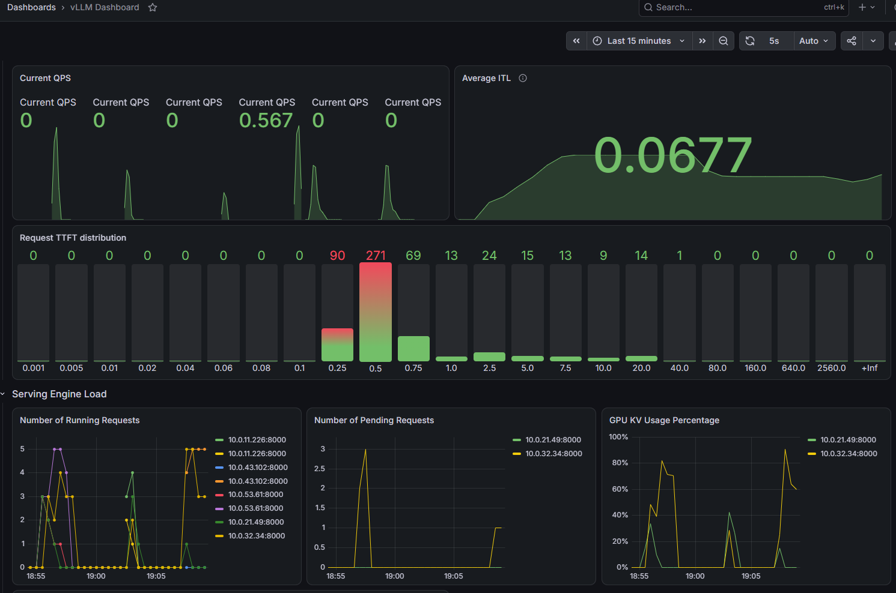

# EKS LLM Inference

[](https://github.com/vladimir-kazarin/eks-llm-inference/actions/workflows/ci.yml)

Production-style LLM serving on AWS: two vLLM replicas on GPU nodes behind a
cache-aware router, built with Terraform and deployed with Argo CD — then
measured on long-context, agent-style traffic.

## What this demonstrates

- **Terraform done properly:** community modules, pinned versions, S3 remote
  state with native locking, nothing account-specific in git.
- **EKS GPU node groups under a hard quota:** 8 G-family vCPUs → exactly
  2× g5.xlarge, tainted so only inference lands there.
- **GitOps with Argo CD + a GitOps bridge:** Terraform hands cluster facts to
  ApplicationSets; every in-cluster change is a commit.
- **Cache-aware LLM routing, measured:** round-robin vs session-sticky vs
  prefix-aware routing on agent sessions growing to ~28k tokens.
- **Guarded lifecycle automation:** `make up` waits for real readiness;
  `make down` cannot orphan a load balancer; benchmarks refuse to run against the
  wrong routing strategy.

## Architecture

```
 laptop                                AWS (1 region, 2 AZs)
 demo.py / bench.py ──HTTP──▶ NLB (source-restricted to allowed_cidrs)
                                 │
                 ┌───────────────┴──── EKS, private subnets ───────────────────┐
                 │ system node group: 2× t3.large                              │
                 │   production-stack router, Argo CD, AWS LB Controller,      │
                 │   kube-prometheus-stack                                     │
                 │ gpu node group: 2× g5.xlarge (taint nvidia.com/gpu)         │
                 │   vLLM replica 1 (Qwen3-4B)   vLLM replica 2 (Qwen3-4B)     │
                 └─────────────────────────────────────────────────────────────┘
                                 ▲
                   Argo CD pulls ┘ public GitHub repo (gitops/)
```

Details and trade-offs: [docs/architecture.md](docs/architecture.md).

## Run it

```bash
make bootstrap      # once: state bucket + budget alert
make up             # ~20–25 min: VPC, EKS, GPU nodes, Argo CD, vLLM, router
make demo           # streamed reply; turn 2 shows prefix-cache hits
make down           # delete the NLB, destroy everything, check for leftovers
```

Full session including benchmarks: [docs/runbook.md](docs/runbook.md).

## Results

Local baseline (two replicas, hand-written gateway): round-robin routing hit the
prefix cache on 18% of prompt tokens; pinning sessions to replicas raised that to
60% and cut median time-to-first-token from 1.3 s to 0.4 s. EKS numbers:
[docs/results.md](docs/results.md).

## Monitoring

kube-prometheus-stack scrapes the router and both vLLM engines; the
production-stack dashboards ship as ConfigMaps through Argo CD (`make grafana`).



During a round-robin run of the long-context agent benchmark:

- **Request TTFT distribution** is bimodal. Most requests land at 0.25–0.75 s,
  because the replica still had most of the session's prefix cached. A tail runs
  out to 10–20 s: those requests had their prefix evicted and recomputed ~18k
  tokens of prefill.
- **GPU KV Usage Percentage** spikes toward 90% as contexts grow. Round-robin
  makes *both* GPUs cache *every* session, so the cache fills and evicts.
- **Number of Running / Pending Requests** shows load spread evenly across the
  two engines (round-robin's one strength) and queueing behind long prefills.

## Repo layout

```
terraform/bootstrap   state bucket + budget (local state, applied once)
terraform/infra       VPC, EKS, node groups, Pod Identity, Argo CD + GitOps bridge
gitops/apps           ApplicationSets: LB controller, NVIDIA plugin, monitoring, llm-stack
gitops/workloads      production-stack Helm values (model, routing strategy)
clients/              demo.py, bench.py, report.py (Python, uv)
scripts/              up / down / wait-ready / set-strategy / validate-gitops
.github/workflows     CI: terraform, tflint, trivy, kubeconform, pytest, shellcheck
```

## Cost (us-east-1, on-demand, approximate)

| Item | $/hr |
|---|---|
| 2× g5.xlarge | ~2.01 |
| 2× t3.large | ~0.17 |
| EKS control plane | 0.10 |
| NAT gateway + NLB | ~0.07 |
| **Total while up** | **~2.35** |

A 2–4 hour session costs about $5–10. Nothing runs between sessions except the
state bucket (cents).
