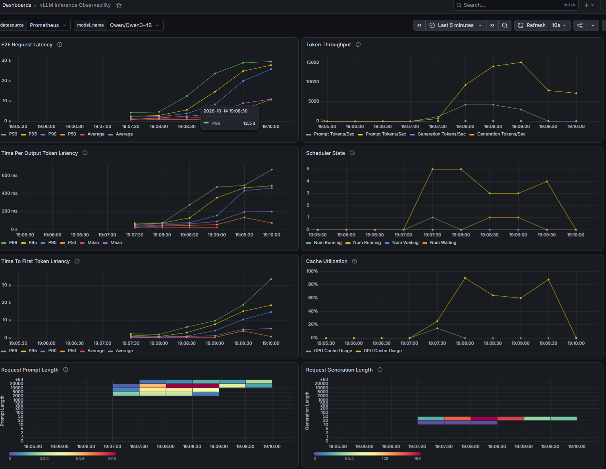

# Results

## Single-machine baseline (local GPU, two vLLM processes, custom `gateway.py`)

Earlier local experiments with the same synthetic agent workload (`local/bench.py`,
predecessor of `clients/bench.py`), vLLM 0.30, Qwen3 (0.6B/4B — the model per run
wasn't recorded), routed by a hand-written gateway.

| strategy | requests | cache hit | TTFT p50 ms | TTFT p95 ms | output tok/s |
|---|---|---|---|---|---|
| cache_on | 40 | 95.4% | 123 | 167 | 36.3 |
| conc2 | 40 | 95.7% | 101 | 135 | 34.6 |
| conc8 | 160 | 20.3% | 2567 | 9161 | 3.7 |
| rr | 96 | 18.0% | 1322 | 4020 | 8.1 |
| sticky | 96 | 60.3% | 381 | 2251 | 10.6 |

- `cache_on` / `conc2` / `conc8`: one replica, 1 / 2 / 8 concurrent sessions.
  At 8 sessions the prefix cache thrashes: hit rate falls from ~95% to ~20%.
- `rr` vs `sticky`: two replicas, 8 sessions. Round-robin spreads each session's
  turns across both replicas, so most turns miss; pinning sessions triples the hit
  rate and cuts median TTFT ~3.5×.
- `output tok/s` is per-stream: local runs didn't record wall-clock time, so
  wall = summed request time.

## EKS: 2× g5.xlarge, Qwen3-4B, vLLM v0.31.0, production-stack router v0.1.13

Workload: 6 concurrent agent sessions × 30 turns, each context growing to ~23k
tokens (`make bench`; the target was 28k, the words→tokens estimate ran high).
Each replica holds roughly 80k tokens of KV cache. Same workload, fresh run id
(no cross-run cache), one run per strategy, 2026-10-14.

| strategy | requests | cache hit | TTFT p50 ms | TTFT p95 ms | output tok/s | wall s |
|---|---|---|---|---|---|---|
| roundrobin | 180 | 64.2% | 681 | 14540 | 31.8 | 154 |
| session | 180 | **93.8%** | **512** | **814** | **63.2** | **82** |
| prefixaware | 180 | 82.1% | 564 | 8993 | 33.1 | 152 |

Share of prompt tokens per engine (Prometheus, `vllm:prompt_tokens_total`):

| strategy | engine A | engine B |
|---|---|---|
| roundrobin | 50% | 50% |
| session | 36% | 64% |
| prefixaware | 80% | 20% |

### What happened

**roundrobin.** Load is perfectly even, but every session's prefix ends up
cached on *both* GPUs: 6 × ~23k ≈ 140k tokens per GPU against ~80k of room.
Early turns are cheap: vLLM matches the longest cached prefix, so a turn
landing on the "other" replica usually recomputes only the 1–2 turns it
missed (131/180 requests recomputed a median of ~740 tokens). From about turn
18 the cache overflows. 43 requests had their prefix evicted and recomputed a
median of 18k tokens, which produced the 14.5 s p95.

**session.** Each session is pinned to one replica by hashing `x-session-id`,
so nothing is duplicated: 6 sessions ≈ 140k tokens across *two* GPUs fits. The
cache-hit rate is 94%, p95 TTFT drops 18× to 0.8 s, and the whole run finishes
in about half the time. The hash split 6 sessions 4:2, which is visible in the
token share, but the busier GPU still had room.

**prefixaware.** Better than round-robin but well short of session (82%, p95
9 s), and it ran into a hotspot: one engine took 80% of the prompt tokens and its
KV cache hit ~90% (screenshot below). The likely cause: every session's system
prompt begins with the same characters (`Run <run-id> session …`), so the
engine that served the first session holds the "longest prefix match" for
*every* new session, and the router keeps choosing it. The chart's
`prefixMinMatchLength` (default 0) is meant to make the router ignore short
shared prefixes like this; tuning it is the obvious next experiment.

### Takeaways

- For agent workloads that already carry a session ID, plain **session
  affinity** gave the best result here: highest cache-hit rate, the shortest
  tail, and 2× the throughput.
- **Prefix-aware routing needs tuning to the prompt shape.** A shared preamble
  (system prompt, tool docs, tenant header) can make it pile everything onto
  one replica.
- **Round-robin's even load is misleading.** It looks balanced on the "running
  requests" panel while silently doubling cache demand.
- Caveats: a single run per strategy, synthetic filler text, 2 replicas. The
  direction is robust; the exact percentages aren't.
